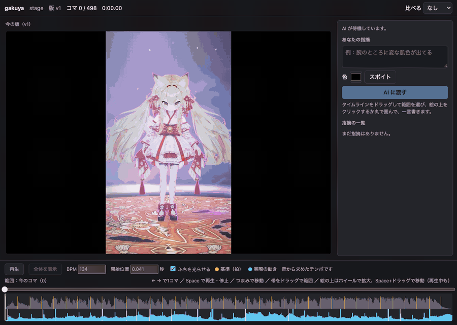
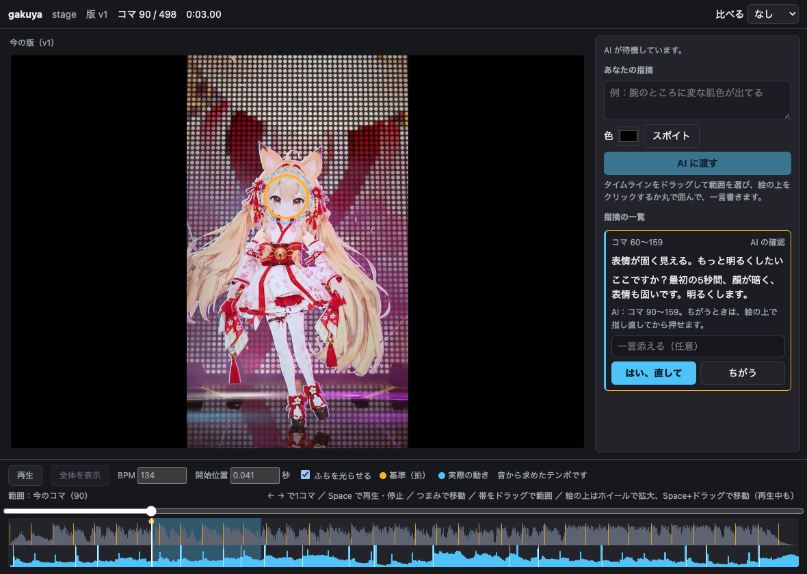
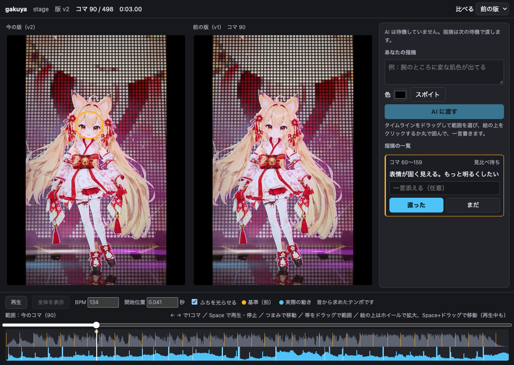

# gakuya

[English](README.md)

書き出した動画を止めて、おかしいところを指さし、話している最中の AI エージェントに渡すアプリです。
エージェントはどこの話と受け取ったかを画面に示し、「はい」のあとで直します。
直した動画は、前の版と同じコマで横に並びます。

AITuber のダンスやステージの確認のために作りました。
ブラウザが再生できる動画なら、内容を問わず使えます。



## 使い方の流れ

gakuya は自分で起動しません。
エージェントに動画を開くよう頼むと、レビューはそのセッションの中で進みます。

```text
人：　　　　　stage.mp4 を gakuya で見よう
エージェント：`gakuya stage.mp4` を裏で起動し、`gakuya wait` で待つ
人：　　　　　範囲をドラッグして丸で囲み、一言書いて「AI に渡す」を押す
エージェント：起きて印の付いたコマを読み、見つけた範囲を枠で示す
```



「はい」を押すまで、修正は始まりません。
場所がちがうときは、指し直して「ちがう」を押します。
修正が終わるとエージェントが新しい動画を渡し、2つの版は同じコマのまま動きます。



## 導入

画面は実行ファイルに埋め込まれるので、実行に要るのは Chrome だけです。
[Releases](https://github.com/kunihiko-t/gakuya/releases) から、手元の環境に合うものを取ってきます。
Apple シリコンは `darwin_arm64`、Intel の Mac は `darwin_amd64`、Linux は `linux_amd64` か `linux_arm64` です。

```bash
curl -L https://github.com/kunihiko-t/gakuya/releases/latest/download/gakuya_darwin_arm64.tar.gz | tar xz
cd gakuya_darwin_arm64
```

実行ファイルは Apple の公証を受けていません。
`curl` ではなくブラウザで落とした場合は、`xattr -d com.apple.quarantine gakuya` を実行するまで macOS に止められます。

実行ファイルに `PATH` を通し、エージェントにスキルを渡します。
Claude Code の場合は次のとおりです。

```bash
ln -s "$PWD/gakuya" ~/.local/bin/gakuya
ln -s "$PWD/skills/gakuya" ~/.claude/skills/gakuya
```

ほかのエージェントでも、コマンドを裏で走らせ、終わったときに起こしてもらえるなら、[skills/gakuya/SKILL.md](skills/gakuya/SKILL.md) の手順で使えるはずです（Claude Code 以外では試していません）。

ソースからビルドするには、[Go](https://go.dev/dl/) 1.27.3 以上と Node 26 以上が要ります。
`npm install` と `npm run build` で `dist/gakuya` ができます。
画面を先にビルドする必要があるため、`go install` だけでは動きません。

## 画面でできること

- **動画を動かす**：ボタンか Space で再生と停止、つまみで移動、矢印キーで1コマずつ進めます。つまみの下の帯をドラッグすると範囲を選べます。
- **近くで見る**：ホイールで拡大し、Space を押しながらのドラッグか中ボタンで移動します。再生中でも使えます。`0` で全体に戻ります。
- **指さす**：絵の上をクリックするか丸で囲み、一言書きます。再生中なら、そのコマで止まります。
- **色を伝える**：色の欄かスポイトで、指摘に色を添えます。
- **比べる**：前の版か、パスで指定した見本の動画を、秒単位のずらしを付けて並べます。2つの絵は一緒に再生、停止、コマ送りします。
- **音を選ぶ**：この動画の音の代わりに、見本の音や、音声ファイル、別の動画の音だけを鳴らせます。波形と拍も鳴っている音から取ります。手で決めたテンポは変わりません。
- **タイミングを見る**：絵のふちが、拍で暖色に、実際の動きの起点で青く光ります。絵そのものは隠しません。テンポの検出がずれていたら、手で直せます。
- **照明を決める**：描画側をつなぐと（`--live`）、動画の音に合わせて描画側の絵を見ながら、エージェントが出したつまみを動かせます。ここで選んだ範囲は拍に吸い付き、繰り返し再生します。「このぐらい」を押すと値がエージェントに届き、押すまでは届きません。描画側は別に用意します（[約束の文書](docs/live-renderer.md)）。

## コマンド

エージェントが、レビューを起動したフォルダで実行します。
全体の手順はスキルに書いてあります。

```text
gakuya <動画> [--review 名前] [--reference 見本の動画] [--audio 音声か動画か reference] [--live 描画側のURL] [--no-open]
gakuya wait [--review 名前]
gakuya propose <指摘ID> --frames 10-20 --region '[[0.1,0.1],[0.3,0.1],[0.3,0.3]]' --text 'ここですか？'
gakuya done <指摘ID> --video 新しい動画.mp4
gakuya timing [--bpm 128] [--offset 0.18] [--cues cues.json]
gakuya live http://127.0.0.1:8917
gakuya knobs --file knobs.json
gakuya reload
gakuya render --video 新しい動画.mp4
```

## 動画の形式

mp4 の H.264 をすすめます。
ほかの形式も、ブラウザが再生できれば使えます。
ProRes のように再生できないものは、白紙にせず絵の上に理由を出します。

コマ番号は表示順に 0 から数えます。
可変フレームレートの動画や、開始時刻が 0 でない動画でも、番号はずれません。

## ファイルと安全性

gakuya は、起動したフォルダの `.gakuya/` に、各版の動画のコピー、指摘、スナップショットを保存します。
動画が入るので、`.gakuya/` は git に入れないでください。
見本の動画と音のファイルはパスを覚えるだけで、コピーしません。

サーバーは `127.0.0.1` だけで待ち受け、起動のたびに作るトークンを求めます。
gakuya はどこにもアップロードしません。
エージェントが読んだスナップショットの扱いは、使うエージェントによります。

## できないこと

- カメラの移動と照明の変更：動画は1つのカメラの絵なので、今のところ視点の変更は拡大と移動だけです。どちらも次に作ります。
- 動画の編集：修正はエージェント側の道具で行い、gakuya は結果を見せます。
- Windows：`gakuya wait` が Unix のシグナルで動作中のサーバーを探すため、今は動きません。
- Chrome 以外のブラウザは未確認です。

## 開発

```bash
npm test
```

実行ファイルをビルドし、Go の試験と、実行ファイルを外から動かすブラウザの試験を走らせます。
上の画像を手元の動画で撮り直す方法は、[scripts/make-demo.mjs](scripts/make-demo.mjs) の先頭にあります。

## ライセンス

[MIT](LICENSE) です。
画面には MPL-2.0 の [mediabunny](https://github.com/Vanilagy/mediabunny) を同梱しています。

`docs/media` の画像はライセンスの対象外です。
画像のキャラクターは作者のもので、例として載せています。
