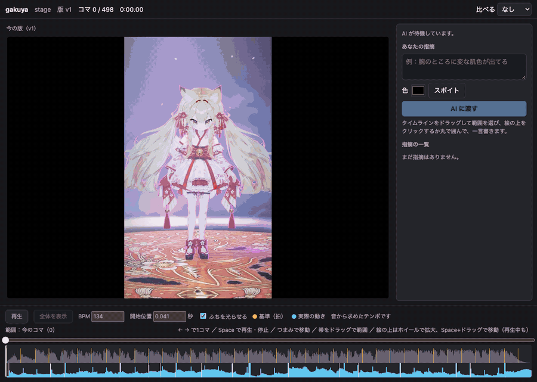
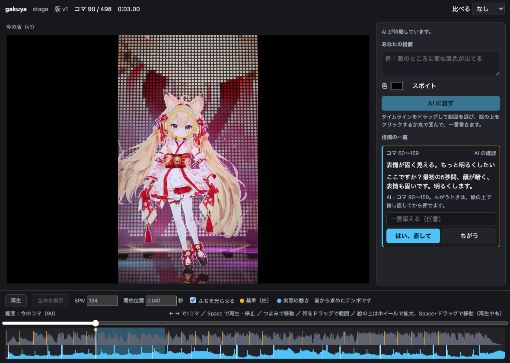
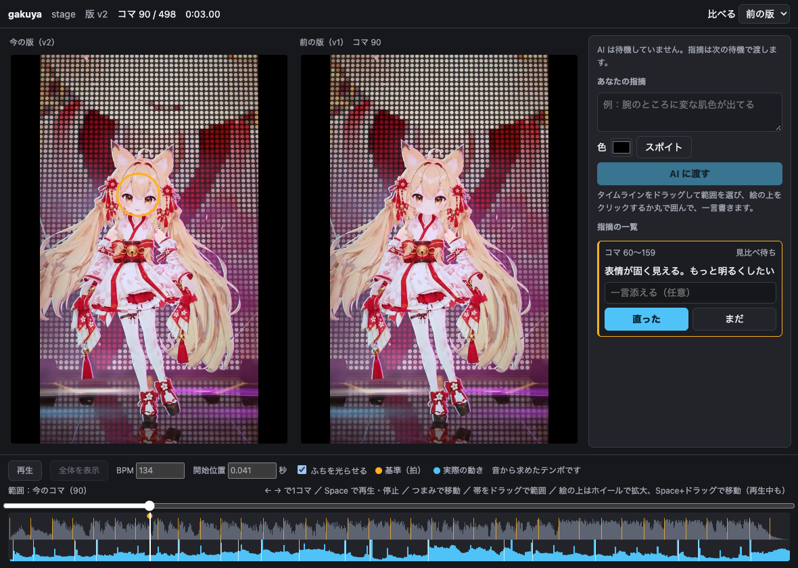

# gakuya

[日本語](README.ja.md)

Stop a rendered video, point at what looks wrong, and hand it to the AI agent you are already talking to. The agent shows you on screen what it thinks you mean, fixes it after you say yes, and the new render opens beside the old one on the same frame. If you have a program that draws the same picture live, you can also set the lights with knobs the agent offers, and tell it "about this much".

It is built for reviewing AITuber dance and stage renders, and works on any video your browser can decode.



## How it works

You don't start gakuya yourself. You ask your agent to open a render, and the review happens inside that agent session.

```text
You:    Let's review stage.mp4 in gakuya.
Agent:  runs `gakuya stage.mp4` in the background, then listens with `gakuya wait`
You:    drag the range, circle the spot, write a line, press "AI に渡す" (send to AI)
Agent:  wakes, reads the frames you marked, and outlines what it found
```



Nothing gets fixed until you press yes. If the agent has the wrong spot, point again and press no. When the fix is ready, the agent hands back the new render, and both versions stay locked to the same frame.



## Install

Running needs only Chrome: the page is embedded in a single binary. Take the archive for your machine from [Releases](https://github.com/kunihiko-t/gakuya/releases): `darwin_arm64` for Apple silicon, `darwin_amd64` for Intel Macs, `linux_amd64` or `linux_arm64` for Linux.

```bash
curl -L https://github.com/kunihiko-t/gakuya/releases/latest/download/gakuya_darwin_arm64.tar.gz | tar xz
cd gakuya_darwin_arm64
```

The binary is not notarized. If you download it with a browser instead of `curl`, macOS blocks it until you run `xattr -d com.apple.quarantine gakuya`.

Put the binary on your `PATH`, and give your agent the skill. For Claude Code:

```bash
ln -s "$PWD/gakuya" ~/.local/bin/gakuya
ln -s "$PWD/skills/gakuya" ~/.claude/skills/gakuya
```

Other agents can follow [skills/gakuya/SKILL.md](skills/gakuya/SKILL.md) as long as they can run a command in the background and be woken when it exits.

To build from source you need [Go](https://go.dev/dl/) 1.27.3 or later and Node 26 or later. `npm install` and `npm run build` make `dist/gakuya`. `go install` does not work on its own, because the page has to be built first.

## In the page

The page is in Japanese for now.

- **Move through the video.** Play and stop with the button or Space, slide the seek bar, step one frame with the arrow keys. Dragging the bar under the seek bar selects a range.
- **Look closer.** Use the wheel to zoom and Space-drag or the middle button to pan, while playing or stopped. `0` shows the whole picture.
- **Point.** Click or circle something on the picture and write a line. If it is playing, it stops on that exact frame.
- **Pick a color.** Use the color box or the eyedropper to attach a color to the note.
- **Compare.** Choose the previous version, or a reference video by its path, with an offset in seconds. Both pictures play, stop and step together.
- **Feel the timing.** A warm ring around the picture pulses on the beat, a blue one where the motion actually starts. The picture itself is never covered. Correct the tempo by hand if the detection is off.
- **Choose the sound.** Play the reference's sound, a sound file, or only the sound of another video in place of this video's. The waveform and beats come from what is playing; a tempo set by hand stays.
- **Set the lights.** With a renderer attached (`--live`), see its picture over the chosen sound and move the knobs the agent offers. A range drawn here lands on beats and repeats. "このぐらい" tells the agent the values; nothing reaches it before that. You bring the renderer: see [the contract](docs/live-renderer.md).

## Commands

The agent runs these from the folder the review was started in. The skill describes the whole loop.

```text
gakuya <video> [--review name] [--reference video] [--audio file-or-video-or-reference] [--live renderer-url] [--no-open]
gakuya wait [--review name]
gakuya propose <note> --frames 10-20 --region '[[0.1,0.1],[0.3,0.1],[0.3,0.3]]' --text 'Here?'
gakuya done <note> --video path/to/new-render.mp4
gakuya timing [--bpm 128] [--offset 0.18] [--cues cues.json]
gakuya live http://127.0.0.1:8917
gakuya knobs --file knobs.json
gakuya reload
gakuya render --video path/to/new-render.mp4
```

## Video formats

Use H.264 in an mp4. Anything else your browser decodes also works. A file it cannot decode, such as ProRes, gets a message on the picture rather than a blank page.

Frame numbers count from 0 in presentation order, so videos with a variable frame rate or a non-zero start time number correctly.

## Your files and security

gakuya keeps its state in `.gakuya/` under the folder you start it in: copies of each version, your notes, their snapshots. **Keep `.gakuya/` out of git.** It holds your renders. A reference video or a sound file is only ever pointed to, never copied.

The server listens on `127.0.0.1` only and requires a token created at each start. Nothing is uploaded. What the agent does with the snapshots it reads depends on the agent you use.

## Not supported

- Moving the camera. A video is one camera's picture, so "changing the view" means zoom and pan.
- Changing the lights without a renderer. A video alone can only show the lights it was rendered with.
- Editing the video. The agent's own tools make the fix; gakuya shows the result.
- Windows. `gakuya wait` finds the running server with a Unix signal, so it does not work there yet.
- Browsers other than Chrome have not been tried.

## Development

```bash
npm test
```

This builds the binary, then runs the Go tests and the browser tests against that binary from the outside. To retake the pictures above with your own renders, see the top of [scripts/make-demo.mjs](scripts/make-demo.mjs).

## License

[MIT](LICENSE). The page bundles [mediabunny](https://github.com/Vanilagy/mediabunny), which is under MPL-2.0.

The license does not cover the images in `docs/media`. The character in them belongs to the author and appears here only as an example.
